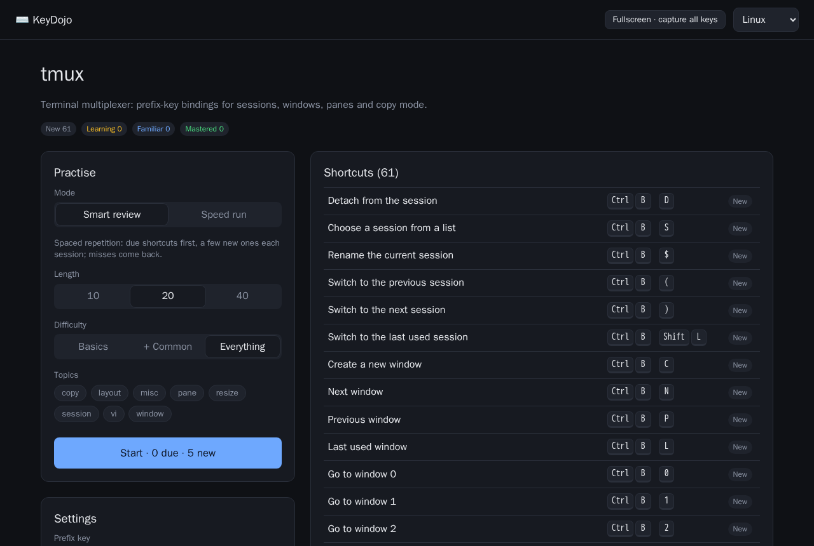
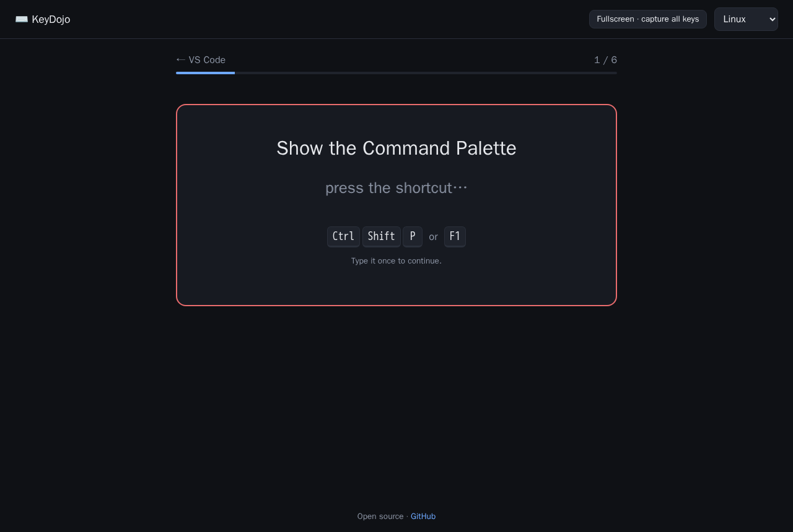

# ⌨️ KeyDojo

**Train keyboard shortcuts into muscle memory** — for VS Code, tmux, StarCraft II, and any app you add as a plugin.

**[Try it online →](https://prehisle.github.io/keydojo/)** · [中文说明](./README.zh-CN.md)

- **Your bindings, not just defaults.** Import your VS Code `keybindings.json` or `tmux list-keys` output and drill what you actually use.
- **Spaced repetition.** Smart review schedules each shortcut based on whether you got it right *and how fast* — hesitation counts.
- **Speed runs.** Race the clock; great for StarCraft hotkeys.
- **Real key sequences.** Combos (`Ctrl+Shift+P`), chords (`Ctrl+K Ctrl+S`), prefix keys (`Ctrl+B %`), and rapid series (`B B`) are all first-class.
- **Plugins are mostly data.** Adding an app is usually one file of shortcut definitions.




## Quick start

```bash
pnpm install
pnpm dev        # http://localhost:5173
pnpm test       # unit tests
pnpm build      # static site in apps/web/dist
```

Requires Node 20+ and pnpm.

## Browser limitations

Browsers never let a page see some shortcuts (`Ctrl+W`, `Ctrl+T`, `Ctrl+N`, `Cmd+Q`, …). KeyDojo detects these and skips them, greyed out in the list. In Chrome/Edge, **Fullscreen · capture all keys** uses the Keyboard Lock API to capture them anyway. The upcoming desktop app removes the limitation entirely (except OS-level keys like `Alt+Tab`).

Switch to an English input method while drilling — IMEs intercept key events.

## Project layout

```
packages/
  core/            key model, matcher, spaced repetition, drill engine, plugin API (no DOM)
  plugin-vscode/   VS Code defaults + keybindings.json importer
  plugin-tmux/     tmux defaults, prefix setting + `tmux list-keys` importer
  plugin-sc2/      StarCraft II, all races, Standard/Grid, generated from game data + `.SC2Hotkeys` importer
apps/
  web/             React + Vite UI
```

## Roadmap

- [ ] Desktop app (Tauri) wrapping `apps/web`, file-backed storage
- [x] StarCraft II: all three races, Grid layout, `.SC2Hotkeys` importer
- [ ] StarCraft II: build-order drills
- [ ] Scenario drills (multi-step tasks, e.g. "rename a symbol across files")
- [ ] More plugins: Vim, JetBrains, Photoshop, Blender, Figma, browser DevTools…
- [ ] i18n of the UI and packs

## Contributing

New plugins and fixes to shortcut data are very welcome — see [CONTRIBUTING.md](./CONTRIBUTING.md).

## License

[MIT](./LICENSE)
